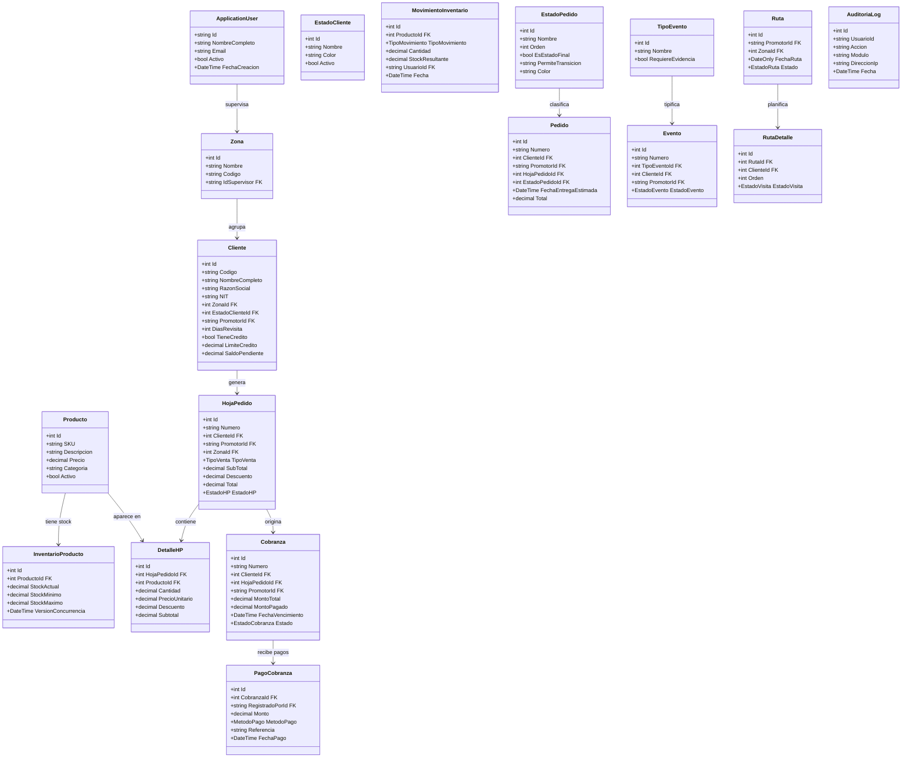
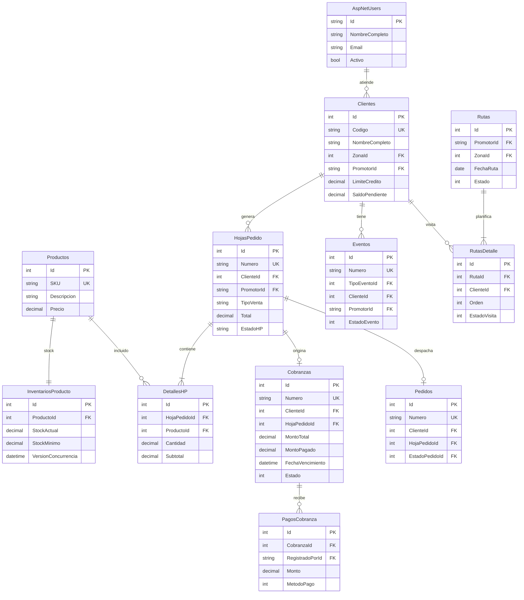
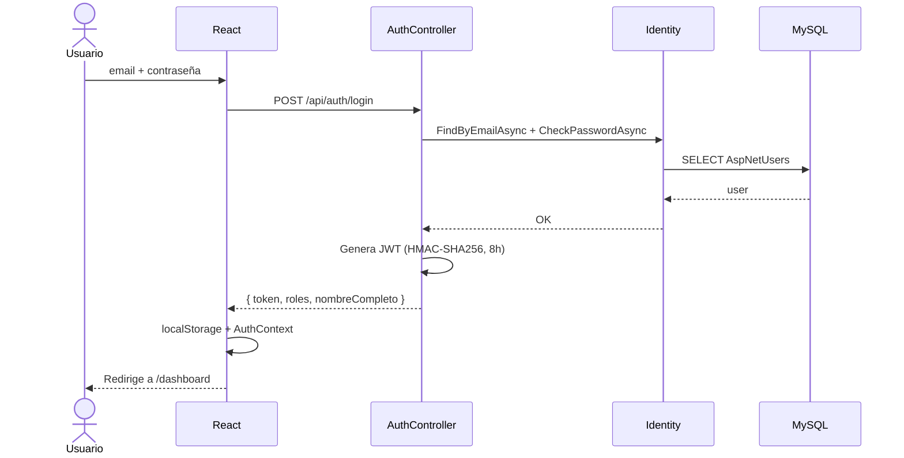
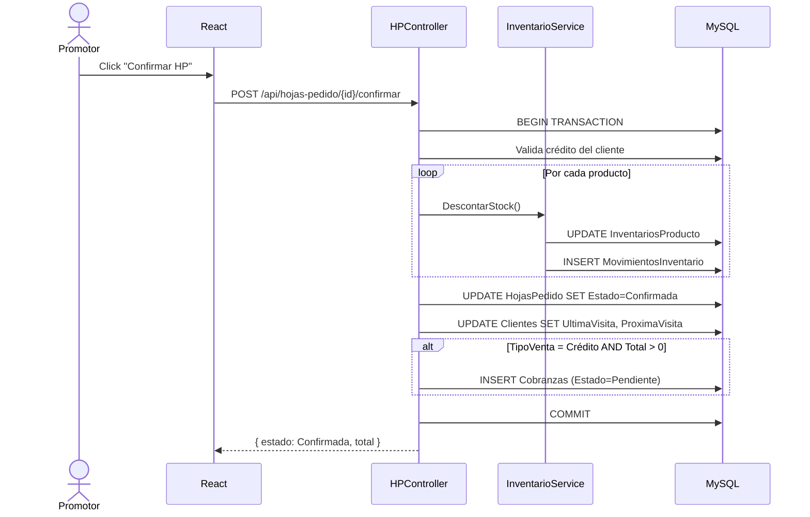
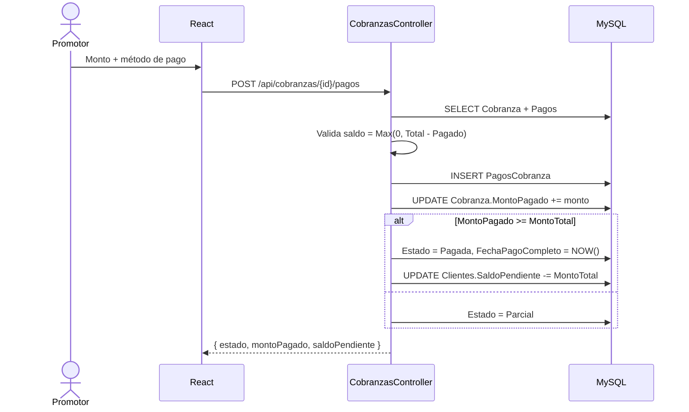
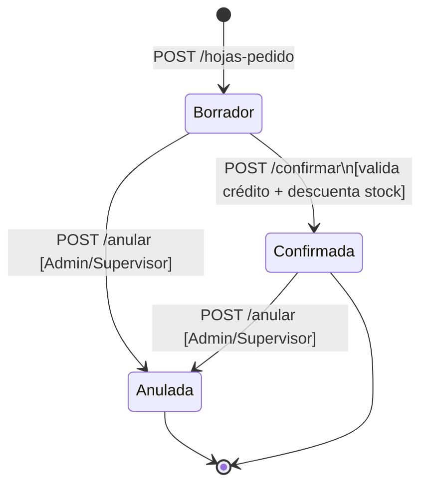
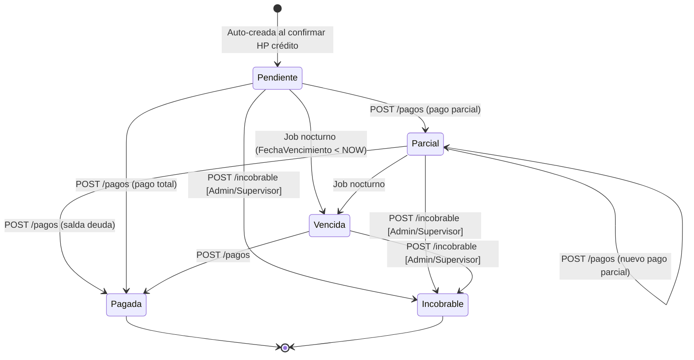
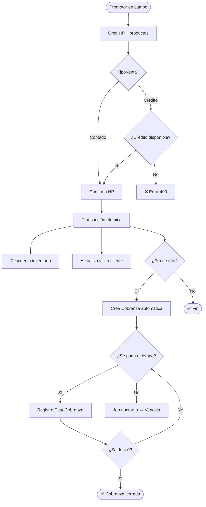
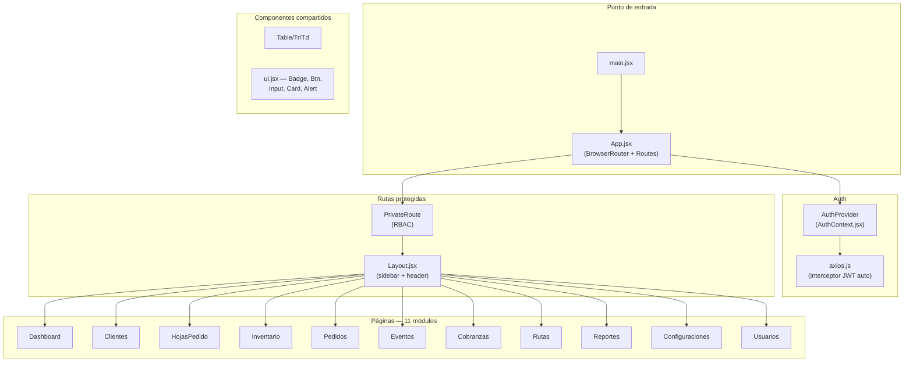

# Documentación Técnica — Control Gestión

**Estado:** Fases 1–6 implementadas y en producción

---

## 1. Diagrama de Clases completo

---

## 2. Diagrama Entidad-Relación

---

## 3. Diagrama de Secuencia — Login

---

## 4. Diagrama de Secuencia — Confirmar HP y crear Cobranza

---

## 5. Diagrama de Secuencia — Registrar Pago de Cobranza

---

## 6. Máquina de estados — HP

---

## 7. Máquina de estados — Cobranza

---

## 8. Flujo completo — Venta a crédito

---

## 9. Arquitectura de componentes React

---

## 10. Decisiones técnicas relevantes

| Decisión | Motivo |
|---|---|
| `ReferenceHandler.IgnoreCycles` global | Relaciones bidireccionales entre entidades causaban ciclos infinitos en la serialización JSON |
| `timestamp(6)` + `ValueGeneratedOnAddOrUpdate` para `VersionConcurrencia` | `uint + IsRowVersion()` es patrón exclusivo de SQL Server; MySQL requiere timestamp para control de concurrencia optimista con Pomelo |
| `Math.Max(0, MontoTotal - MontoPagado)` en cálculo de saldo | Evita valores negativos en cobranzas con datos de prueba inconsistentes |
| Validación `Total > 0` en HP Create | Previene creación de cobranzas con monto negativo cuando el descuento supera el subtotal |
| Middleware de auditoría corre DESPUÉS de `_next` | Garantiza que `context.User` esté poblado con el JWT ya validado y que solo se registren operaciones que llegaron al pipeline |
| Filtro `hasta` = fin de día en reportes | Las fechas enviadas desde el frontend son `yyyy-MM-dd` (medianoche UTC); sin ajuste se excluyen todos los registros del día seleccionado |
